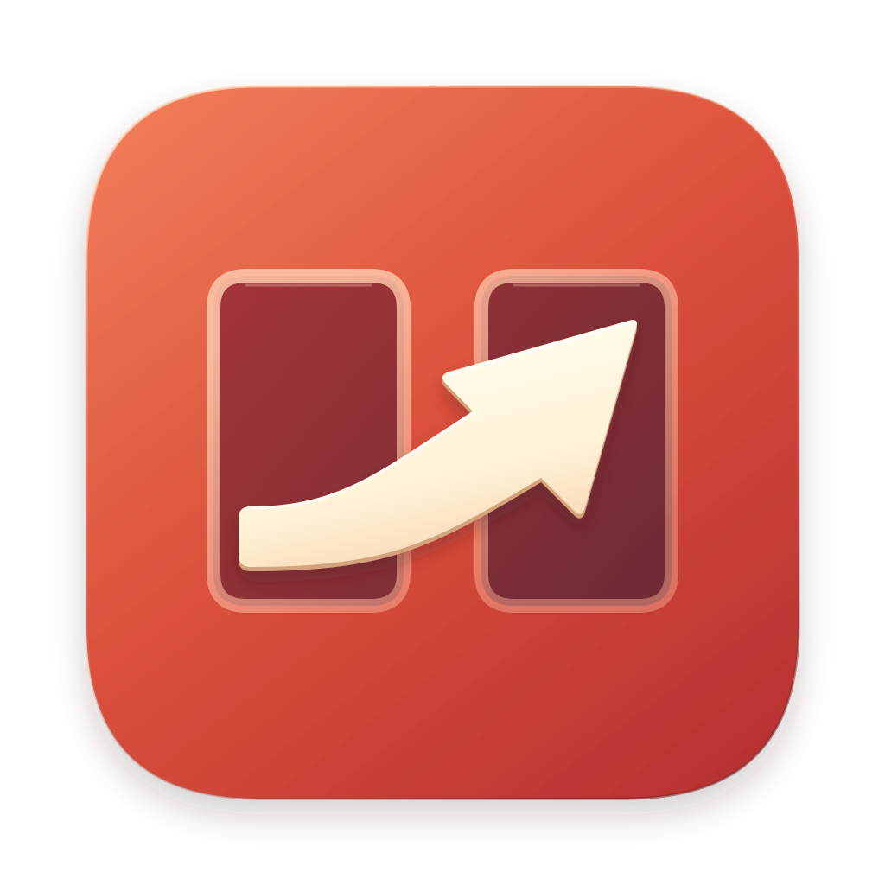

<p align="center"></p>

# Slipway

Une souris, un clavier et un presse-papiers pour plusieurs Mac. On pousse le curseur contre le bord de l'écran et il
passe sur le Mac d'à côté, par le réseau local. Pensé pour des Mac sur des comptes Apple différents, là où Contrôle
universel ne marche pas.

- Mouvements en UDP, un datagramme par événement, en position absolue : pas de dérive ni de saccade quand un paquet se perd.
- Clavier, clics et presse-papiers en TCP, sans touche coincée : tout est relâché si le lien tombe.
- Presse-papiers partagé : texte, images, et fichiers, dossiers ou apps copiés dans le Finder (⌘C sur un Mac, ⌘V dans
  le Finder de l'autre, jusqu'à 256 Mo). Les mots de passe copiés depuis un gestionnaire ne partent jamais.
- Chiffré et authentifié de bout en bout (X25519, Ed25519, ChaCha20-Poly1305). Premier contact : le même code à
  6 chiffres s'affiche sur les deux Mac et doit être confirmé des deux côtés.
- Découverte Bonjour, reconnexion automatique, adresse IP en secours.
- Disposition des écrans à la souris, partagée entre les Mac. Latence, gigue et pertes affichées.
- Raccourcis : ⌃⌥⌘L tout rendre en local, ⌃⌥⌘1…9 aller au n-ième Mac.

macOS 26 ou plus récent. Interface en français.

## Installer

1. Télécharger `Slipway-<version>.dmg` dans les [Releases](https://github.com/AnthonyTrtre/slipway/releases/latest)
   et glisser Slipway dans Applications, sur chaque Mac.
2. L'app n'est pas notarisée par Apple : au premier lancement, clic droit sur Slipway › Ouvrir (ou
   Réglages Système › Confidentialité et sécurité › Ouvrir quand même).
3. Autoriser Slipway dans Réglages Système › Confidentialité et sécurité › Accessibilité et Surveillance de l'entrée,
   puis accepter l'accès au réseau local.
4. Sur un Mac, choisir l'autre Mac dans le menu, comparer le code à 6 chiffres et confirmer sur les deux.

Les mises à jour arrivent ensuite toutes seules (Sparkle) : l'app consulte `appcast.xml` de la dernière Release
GitHub toutes les 6 heures, télécharge l'archive, vérifie sa signature EdDSA et s'installe.

## Réseau et vie privée

Aucun compte, aucun serveur, aucune télémétrie. Slipway n'échange qu'avec vos Mac du réseau local (TCP 24850,
UDP 24851, Bonjour `_slipway._tcp`). La seule connexion vers Internet est la recherche de mises à jour sur
github.com, désactivable dans les préférences de l'app (`defaults write fr.anthony.slipway SUEnableAutomaticChecks -bool false`).

## Compiler

```
brew install xcodegen
make test-kit     # logique pure (aussi sous Linux : cd SlipwayKit && swift test)
make test         # + tests de l'app
make installer    # compile en Release et installe dans /Applications
```

Le projet est généré par XcodeGen (`project.yml`). Pour signer avec votre équipe, changez `DEVELOPMENT_TEAM`.

- `SlipwayKit/` : toute la logique (protocole, géométrie, session, sécurité, moteur), testable sans macOS.
- `Sources/` : l'app de barre de menus (SwiftUI). `Socle/` : petits modules partagés.
- `docs/protocole.md` : spécification du protocole v1 ; `docs/octets-de-reference/` : trames et vecteurs crypto.

## Licence

MIT, voir [LICENSE](LICENSE). Sparkle (MIT) pour les mises à jour. Slipway est une réimplémentation originale :
il ne reprend ni le code ni le protocole de Synergy ou de Deskflow.
